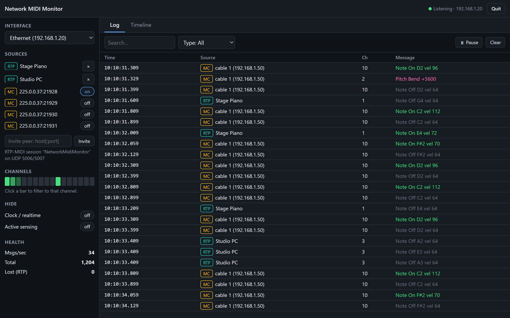
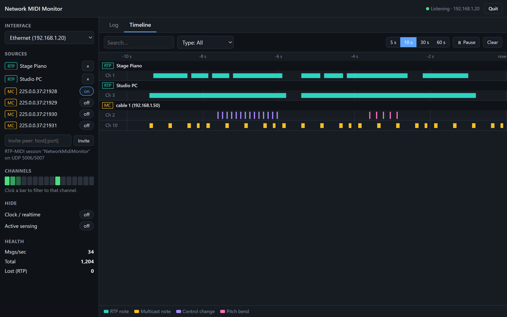

# Network MIDI Monitor

[](https://github.com/yorkshiretwist/NetworkMidiMonitor/actions/workflows/ci.yml)
[](LICENSE)

A small Python app with a browser UI that monitors MIDI messages on your network, from both
**RTP-MIDI** (Apple Network MIDI, as used by rtpMIDI and rtpmidid) and **UDP multicast MIDI** (as used by
QmidiNet and ipMIDI). It is read-only: it shows what is on the network and never sends MIDI.





*Both screenshots show made-up sample data, with invented names and addresses.*

## Contents

- [Why this exists](#why-this-exists)
- [Features](#features)
- [Requirements](#requirements)
- [Install and run](#install-and-run)
- [Using the monitor](#using-the-monitor)
- [Connecting your MIDI sources](#connecting-your-midi-sources)
  - [RTP-MIDI](#rtp-midi) ([rtpMIDI on Windows](#rtpmidi-on-windows), [rtpmidid on Linux](#rtpmidid-on-linux), [macOS and others](#macos-ios-and-hardware), [invite by address](#invite-a-peer-by-address))
  - [Multicast MIDI](#multicast-midi) ([QmidiNet on Linux](#qmidinet-on-linux), [ipMIDI on Windows](#ipmidi-on-windows))
- [Troubleshooting](#troubleshooting)
- [What has been tested](#what-has-been-tested)
- [Limits](#limits)
- [Security](#security)
- [Documentation and contributing](#documentation-and-contributing)
- [Licence](#licence)

## Why this exists

There are two common ways to send MIDI over a network, and they **do not talk to each other**:

| | RTP-MIDI | UDP multicast MIDI |
| --- | --- | --- |
| What it is | The Apple Network MIDI protocol ([RFC 6295](https://www.rfc-editor.org/rfc/rfc6295)) plus Apple's session handshake | Raw MIDI bytes in UDP multicast packets (a convention, not a standard) |
| Typical software | [rtpMIDI](https://www.tobias-erichsen.de/software/rtpmidi.html) (Windows), macOS Audio MIDI Setup, [rtpmidid](https://github.com/davidmoreno/rtpmidid) (Linux), iOS apps | [QmidiNet](https://qmidinet.sourceforge.io/) (Linux), ipMIDI (Windows), multimidicast |
| How devices connect | Sessions: each side invites the other, and they find each other with Bonjour/mDNS | No sessions: everyone sends to, and listens on, one multicast address and port |
| Default ports | UDP 5004 and 5005 (control and data) | `225.0.0.37`, UDP 21928 (cable 1), 21929 (cable 2), ... |

A Windows PC running rtpMIDI and a Linux PC running QmidiNet cannot see each other's MIDI. This monitor
understands both, so you can see everything in one window and check that each side is actually sending
what you think it is. (To make the two worlds talk to each other you need a bridge: use ipMIDI on
Windows, or rtpmidid on Linux.)

## Features

- **Both protocols in one view.** RTP-MIDI peers and multicast cables appear side by side, each tagged `RTP` or `MC`.
- **Log tab.** A live table of messages: time, source, channel and a decoded message such as `Note On C4 vel 100`. Hover a row for the raw bytes. Search, filter by message type, click the channel meter to filter by channel, pause and clear.
- **Timeline tab.** Note bars (Note On to Note Off, held notes run to "now"), and ticks for controller and pitch bend messages, grouped by source and channel over the last 5, 10, 30 or 60 seconds.
- **Joins RTP-MIDI as a session peer.** It announces itself over Bonjour/mDNS so it shows up in rtpMIDI's Directory, accepts invitations, and can invite a peer by address. Lost packets are counted.
- **Multicast cables.** Four cables (ports 21928 to 21931) with an on/off switch each, on the network interface you pick.
- **Runs locally.** A small web server on `127.0.0.1`; nothing leaves your network and there is no account or telemetry.

## Requirements

| | |
| --- | --- |
| **Python** | **3.11 or newer.** Developed and hand-tested on 3.14. The CI workflow also runs the test suite on 3.11, 3.12 and 3.13. |
| **Operating system** | **Windows 10/11** and **Linux**. Developed and hand-tested on Windows 11. The CI workflow also runs the automated tests on Linux. macOS is not tested (see [What has been tested](#what-has-been-tested)). |
| **Python packages** | [aiohttp](https://github.com/aio-libs/aiohttp) 3.9 or newer and [zeroconf](https://github.com/python-zeroconf/python-zeroconf) 0.130 or newer. Installed for you by `run.bat` / `run.sh` or `pip`. |
| **Browser** | Any current browser (Chrome, Edge, Firefox, Safari). |
| **Network** | The monitor and the senders must be on the **same subnet** (same router, no guest-network isolation). Multicast must be allowed, which some Wi-Fi networks block. |
| **Windows only (recommended)** | The Bonjour service. It is installed with rtpMIDI and with iTunes, and the monitor uses it to announce itself so rtpMIDI can see it. |

## Install and run

### Option 1: the release zip (easiest)

1. Install [Python 3.11 or newer](https://www.python.org/downloads/). On Windows, tick **Add python.exe to PATH**.
2. Download `NetworkMidiMonitor-<version>.zip` from the [Releases page](https://github.com/yorkshiretwist/NetworkMidiMonitor/releases) and unzip it.
3. Start it:
   - **Windows:** double-click `run.bat`.
   - **Linux:** run `./run.sh` in a terminal. On Debian and Ubuntu you may first need `sudo apt install python3-venv`.

The first run creates a private Python environment in a `.venv` folder next to the script and installs the
two dependencies into it (this needs an internet connection once). After that it starts straight away. Your
browser opens at <http://127.0.0.1:8080/>.

Each release also lists a SHA-256 checksum for the zip so you can check your download.

### Option 2: from source

```bash
git clone https://github.com/yorkshiretwist/NetworkMidiMonitor.git
cd NetworkMidiMonitor
python -m venv .venv
# Windows:      .venv\Scripts\activate
# Linux, macOS: source .venv/bin/activate
pip install .
python -m networkmidimonitor
```

To work on the code, use `pip install -e ".[test]"` instead and see [CONTRIBUTING.md](CONTRIBUTING.md).

### Command-line options

| Option | Meaning |
| --- | --- |
| `--port 8080` | Port for the web UI (default 8080). |
| `--host 127.0.0.1` | Address for the web UI (default: this computer only). See [Security](#security) before changing it. |
| `--no-browser` | Don't open the browser automatically. |
| `--no-mdns` | Don't announce the RTP-MIDI session over mDNS. Peers must then invite the monitor by address. |
| `-v`, `--verbose` | Log debug detail to the terminal. Please use this when reporting a bug. |
| `--version` | Print the version. |

With `run.bat` / `run.sh`, add the options after the command, for example `.\run.bat --port 9000` (Windows) or `./run.sh --port 9000` (Linux). Use the `.\` or `./` at the start when you run it from a terminal.

Your choices (network interface, which multicast cables are on) are saved in `.networkmidimonitor.json` in your home folder.

### Stopping it

Click **Quit** (top right of the page), or press **Ctrl+C** in the terminal. Both shut down cleanly: the monitor
says goodbye to its RTP-MIDI peers and withdraws its Bonjour announcement.

## Using the monitor

**Sidebar** (shared by both tabs)

- **Interface:** the network adapter to use. Pick the one on the same network as your MIDI senders, not a virtual or Bluetooth adapter.
- **Sources:** connected RTP-MIDI peers (use **×** to disconnect one), the four multicast cables with an on/off switch, and an **Invite peer** box. The line underneath shows the RTP-MIDI session name and the ports it is using.
- **Channels:** a meter of MIDI channels 1 to 16 showing recent activity. Click a bar to show only that channel; click again to clear.
- **Hide:** hide timing clock and active-sensing messages, which can drown out everything else.
- **Health:** messages per second, total messages, and RTP-MIDI packets lost.

**Log tab:** the newest messages are at the bottom. **Pause** freezes the display (messages are still collected, and appear when you resume). **Clear** empties it. The search box matches the message text, source and raw bytes.

**Timeline tab:** choose a 5, 10, 30 or 60 second window. Teal bars are RTP-MIDI notes and amber bars are multicast notes. Purple ticks are control changes and pink ticks are pitch bends. Hover for details. **Pause** freezes the timeline. The search box, type filter, source switches and Hide settings apply to both tabs.

## Connecting your MIDI sources

Start the monitor first and choose the right **Interface** in the sidebar. Then follow the steps for the kind of
software that is sending.

> **Which protocol is my software using?** If it talks about *sessions*, *participants*, *invitations*,
> *Bonjour* or *Apple Network MIDI*, it is RTP-MIDI. If it talks about a *multicast address* and a *UDP port*
> (usually 225.0.0.37 and 21928), it is multicast MIDI.

### RTP-MIDI

The monitor appears to your RTP-MIDI software as a participant called **NetworkMidiMonitor**. It listens on UDP
**5006 and 5007** (not 5004 and 5005, so it doesn't clash with rtpMIDI running on the same computer). The
sidebar shows the ports it is actually using.

#### rtpMIDI on Windows

This works whether rtpMIDI is on the same PC as the monitor or on another PC on the network.

1. Install and open [rtpMIDI](https://www.tobias-erichsen.de/software/rtpmidi.html). Under **My Sessions**, make sure you have a session (click **+** to make one if the list is empty) and that it is enabled.
2. Start the monitor.
3. In rtpMIDI, look in the **Directory** on the right for **NetworkMidiMonitor**. Select it and click **Connect**. It then appears in your session's participants list as connected.
4. *If it is not in the Directory,* add it by hand: select your session, click **+** under **Participants**, enter any name, the monitor computer's address as the host (`127.0.0.1` if it is the same PC) and port **5006**, then click **Connect**. See [Troubleshooting](#the-monitor-is-not-in-rtpmidis-directory) if you want to find out why it was not listed.
5. In the monitor's sidebar, an **RTP** row named after your rtpMIDI session appears under **Sources**.
6. Send some MIDI into the rtpMIDI session. In your MIDI program (or on your keyboard), choose the rtpMIDI session's MIDI port as the output. Messages appear in the Log with the `RTP` tag and the session's name as the source.

#### rtpmidid on Linux

[rtpmidid](https://github.com/davidmoreno/rtpmidid) finds RTP-MIDI services on the network with Avahi and turns them into ALSA MIDI ports, so it will find the monitor on its own.

1. Make sure `rtpmidid` and the Avahi daemon are running (`systemctl status rtpmidid avahi-daemon`).
2. Start the monitor. In the sidebar, an **RTP** row named after the Linux machine's ALSA port appears under **Sources** a few seconds later. rtpmidid has connected to the monitor itself.
3. **Connect your MIDI device to the `NetworkMidiMonitor` port.** The monitor is connected but nothing is sent until a MIDI source is wired to it. Run `aconnect -l` to see the ports, then connect your device to the `NetworkMidiMonitor` port (for example `aconnect 20:0 128:0`, with the numbers from your own listing). If you use JACK or PipeWire, connect your device to the `NetworkMidiMonitor` port in the **rtpmidid** box of the graph (qjackctl, Catia or similar).
4. Play. Messages appear in the Log with the `RTP` tag.

If you want to check what rtpmidid sees: `avahi-browse -rt _apple-midi._udp` lists the RTP-MIDI services on the network, and should include `NetworkMidiMonitor`.

#### macOS, iOS and hardware

macOS (Audio MIDI Setup > MIDI Studio > Network), iPad and iPhone apps and hardware RTP-MIDI units use the
same protocol, so they should work: add **NetworkMidiMonitor** (or the monitor's address and port 5006) as a
participant of the session, and send MIDI to that session. This has **not been tested**; please
[tell us](https://github.com/yorkshiretwist/NetworkMidiMonitor/issues/new?template=compatibility_report.yml)
whether it works for you.

#### Invite a peer by address

If your software can't find the monitor, or you want the monitor to start the connection, type the sender's
address into the **Invite peer** box in the sidebar and press Enter. Use `host` or `host:port`; the port is
the RTP-MIDI *control* port of the session you are inviting (5004 if you have not changed it). The peer then
appears under **Sources**, or nothing happens if the other side doesn't accept the invitation (the monitor
gives up after about 12 seconds).

For rtpMIDI the port is the one shown next to your session under **My Sessions**. Note that rtpmidid also
publishes each ALSA port as its own service on a random port; inviting those from the monitor did not work in
testing, so let rtpmidid connect to the monitor as described above instead.

### Multicast MIDI

There is nothing to connect on the monitor side: it listens on `225.0.0.37` and turns on the cables you
choose in the sidebar. **Cable 1 is UDP port 21928**, cable 2 is 21929 and so on. Cable 1 is on by default. The
sender and the monitor just have to use the same address and port, and be on the same network.

#### QmidiNet on Linux

[QmidiNet](https://qmidinet.sourceforge.io/) turns the MIDI that arrives at its ALSA/JACK MIDI input into multicast packets.

1. Start `qmidinet`. Open its options and check that the **multicast address** is `225.0.0.37`, the **UDP port** is `21928`, and the **network interface** is your LAN adapter (for example `eth0` or `wlan0`), *not* `lo`. Restart QmidiNet if you changed anything. (`qmidinet --help` lists the equivalent command-line options.)
2. In the monitor, check that cable 1 is **on** in the sidebar (it is by default), and that the **Interface** is the one on the same network as the Linux machine.
3. **Connect your MIDI device to QmidiNet.** QmidiNet only sends what arrives at its input, so an unconnected keyboard sends nothing even though it sounds fine locally. In the JACK or PipeWire graph (qjackctl, Catia and similar), connect your device's MIDI output to QmidiNet's MIDI input. With plain ALSA, run `aconnect -l` to see the client and port numbers, then `aconnect <your-device> <qmidinet-port>`. To play a file instead: `aplaymidi -p <qmidinet-port> some.mid`.
4. Play. Messages appear in the Log tagged `MC`, with a source like `cable 1 (192.168.1.50)`, where the address is the Linux machine's.

If you only want to check that the network works, you can send two test messages from the Linux machine without QmidiNet or any MIDI hardware:

```bash
python3 - <<'EOF'
import socket
s = socket.socket(socket.AF_INET, socket.SOCK_DGRAM)
s.setsockopt(socket.IPPROTO_IP, socket.IP_MULTICAST_IF, socket.inet_aton("YOUR-LINUX-LAN-IP"))
s.setsockopt(socket.IPPROTO_IP, socket.IP_MULTICAST_TTL, 2)
for message in (b"\x90\x3c\x64", b"\x80\x3c\x00"):   # Note On C4, then Note Off C4
    s.sendto(message, ("225.0.0.37", 21928))
EOF
```

You should see `Note On C4 vel 100` and `Note Off C4 vel 0` in the monitor. If you do, the network is fine and any
remaining problem is on the QmidiNet side (interface or MIDI connection).

#### ipMIDI on Windows

[ipMIDI](https://www.nerds.de/en/ipmidi.html) uses the same multicast convention (address `225.0.0.37`,
ports from 21928 upwards), and QmidiNet describes itself as ipMIDI-compatible. Choose the same port as the
cable you turned on in the monitor and play into the ipMIDI port. This has **not been tested** with this
monitor.

#### Several cables and other addresses

Turn on the extra cables (21929 to 21931) in the sidebar if your senders use them. The multicast address is
`225.0.0.37`; to use a different one, set `"mc_group"` in `.networkmidimonitor.json` (in your home folder)
while the monitor is not running.

## Troubleshooting

Run the monitor with `-v` to see what it is doing. The sidebar's red text shows problems opening ports.

### Nothing arrives from a multicast sender

1. **Is the sender actually sending?** On the sender's computer (Linux), run `sudo tcpdump -i any -n 'host 225.0.0.37'` and play something. If nothing shows, the problem is in the sender: wrong interface selected, or nothing connected to its MIDI input (see [QmidiNet](#qmidinet-on-linux) step 3).
2. **Right interface?** The monitor joins the multicast group on the adapter you chose. On a computer with several adapters (Wi-Fi, Ethernet, VPNs, virtual machines), pick the one on the sender's network.
3. **Wi-Fi?** Many routers and access points drop or slow multicast on Wi-Fi. If either computer is on Wi-Fi and nothing arrives, try Ethernet on at least one side.
4. **Windows firewall.** Allow `python.exe` through the firewall on your **Private** network when Windows asks, or add an inbound UDP rule for it. The real program is the Python that runs the monitor (for example `...\Python\pythoncore-3.14-64\python.exe`), not the `.venv` launcher. Also check your network is set to **Private** rather than Public in Windows' network settings.
5. **Port already in use.** The sidebar shows a red message if the monitor can't open a multicast port (another program may hold it).

### The monitor is not in rtpMIDI's Directory

- Check the monitor is running and that you didn't start it with `--no-mdns`.
- On Windows, make sure the **Bonjour Service** is running (`Get-Service "Bonjour Service"` in PowerShell). The monitor announces itself through it, using `dns-sd`. `dns-sd -B _apple-midi._udp` in a terminal lists everything Bonjour can see, and should list `NetworkMidiMonitor`.
- Close and reopen the rtpMIDI window, or just [add the participant by hand](#rtpmidi-on-windows) (step 4).

### An RTP-MIDI peer is connected but no messages arrive

- With rtpmidid, a device has to be connected to the `NetworkMidiMonitor` port ([rtpmidid step 3](#rtpmidid-on-linux)).
- With rtpMIDI, check you are sending to the session's MIDI port and that the monitor shows as connected in the participants list.

### An invitation does nothing

The other side has to accept it, and must be reachable on that address and port. The monitor gives up after about 12 seconds. If you invite `127.0.0.1:5004` and nothing happens, check that rtpMIDI is running with a session enabled on that port.

### "RTP-MIDI unavailable" in the sidebar

The monitor couldn't open its UDP ports (5006/5007 or the next free pair). Check what is using them and close it, or look at `-v` output.

### Windows shows a firewall prompt each time

The prompt is for the real `python.exe`. Choose **Allow** for Private networks once and it stops.

### Something else

Run with `-v` and [open an issue](https://github.com/yorkshiretwist/NetworkMidiMonitor/issues/new/choose) with the output (remove any addresses you want to keep private).

## What has been tested

By hand, on real software:

| Sender | Monitor on | Result |
| --- | --- | --- |
| rtpMIDI (Windows), same PC as the monitor | Windows 11 | Works, including discovery and connection from the rtpMIDI Directory |
| rtpmidid (Linux) on another PC | Windows 11 | Works |
| QmidiNet (Linux) on another PC | Windows 11 | Works |
| Timeline with RTP-MIDI and multicast at once | Windows 11 | Works |

**Not tested yet:** the monitor running on Linux or macOS (the automated tests are set up to run on Linux in CI), macOS Network MIDI sessions, iOS apps, hardware RTP-MIDI units, ipMIDI, and heavy traffic over long periods. Reports are welcome: use the [compatibility report](https://github.com/yorkshiretwist/NetworkMidiMonitor/issues/new?template=compatibility_report.yml) form.

## Limits

- **Read-only.** There is no MIDI output, and no recording or export yet.
- **No recovery journal.** RTP-MIDI can include a journal that lets a receiver repair lost packets. The monitor ignores it: it counts lost packets (the **Lost (RTP)** figure) but does not fix them, so a lost Note Off can leave a note drawn as held on the Timeline until the next Note On for that note.
- **Four multicast cables** at the default address.
- **The log keeps the last 5,000 messages** and shows the latest 1,000.
- **IPv4 only.**

## Security

The web UI has **no login**. By default it listens only on `127.0.0.1`, so only programs on your own computer can reach it. The UI can invite RTP-MIDI peers and shut the monitor down, so only use `--host` to expose it on a network you trust. Each WebSocket connection is checked against the page's own origin, which stops other websites from driving a monitor running on your computer. To report a vulnerability, see [SECURITY.md](SECURITY.md).

## Documentation and contributing

- [docs/developers.md](docs/developers.md): how it works inside: architecture, the protocols, the WebSocket messages, the Timeline, the tests.
- [CONTRIBUTING.md](CONTRIBUTING.md): how to report problems, set up, test and send changes.
- [CODE_OF_CONDUCT.md](CODE_OF_CONDUCT.md) and [SECURITY.md](SECURITY.md).
- [release.md](release.md): what changed in each release.
- [THIRD-PARTY-NOTICES.md](THIRD-PARTY-NOTICES.md): the software this uses, and the names of products it works with.

## Licence

Network MIDI Monitor is free software, licensed under the
[GNU General Public License v3.0 or later](LICENSE) (GPL-3.0-or-later).

It is an independent project. It is **not affiliated with or endorsed by** the makers of rtpMIDI, QmidiNet, rtpmidid, ipMIDI or Apple; those names are used only to say what it works with.
