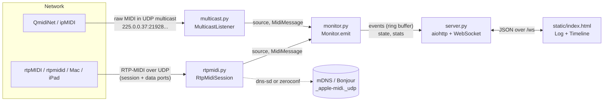
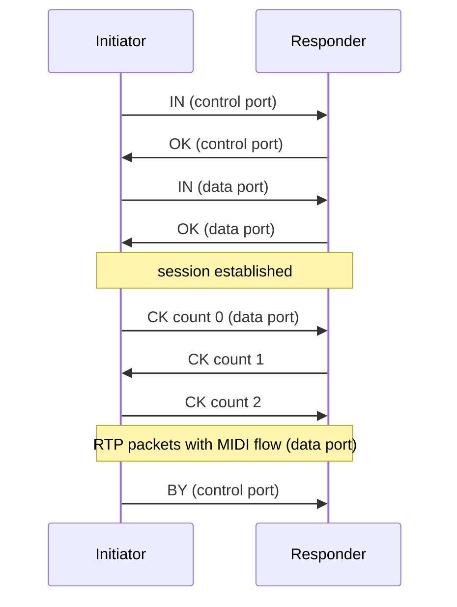

# How Network MIDI Monitor works

This page is for people who want to understand, change or extend the code. For installing and using the
monitor, see the [README](../README.md); for how to contribute, see [CONTRIBUTING.md](../CONTRIBUTING.md).

- [The big picture](#the-big-picture)
- [Code map](#code-map)
- [Turning bytes into messages](#turning-bytes-into-messages)
- [UDP multicast MIDI](#udp-multicast-midi)
- [RTP-MIDI](#rtp-midi)
- [Announcing over mDNS](#announcing-over-mdns)
- [The core: events, settings and statistics](#the-core-events-settings-and-statistics)
- [The web server and the WebSocket protocol](#the-web-server-and-the-websocket-protocol)
- [The web UI](#the-web-ui)
- [Security model](#security-model)
- [Tests](#tests)
- [Extending it](#extending-it)
- [Design decisions and history](#design-decisions-and-history)
- [Known limits](#known-limits)

## The big picture

The monitor is one Python process that listens on the network, decodes MIDI, and pushes it to a web page
over a WebSocket. Everything runs in a single asyncio event loop: there are no threads in the Python code.



The two listeners know nothing about the web UI, and the web server knows nothing about the protocols. They
meet in `Monitor`, which owns the listeners, the settings and the buffer of recent events. Both listeners
report a message by calling `Monitor.emit(source, message)` with a human-readable source name and a decoded
`MidiMessage`.

## Code map

| File | Responsibility |
| --- | --- |
| `networkmidimonitor/midi.py` | MIDI bytes to `MidiMessage` (kind, channel, text): `read_message`, `decode`, `StreamParser` |
| `networkmidimonitor/rtpmidi.py` | RTP-MIDI payload parser, Apple session packet builders and parser, `RtpMidiSession` (the session peer) |
| `networkmidimonitor/multicast.py` | `MulticastListener`: one UDP socket per cable, joined to the multicast group |
| `networkmidimonitor/monitor.py` | `Monitor` (wiring, event buffer, commands, state), `Settings`, interface listing |
| `networkmidimonitor/server.py` | aiohttp app: serves the page, the `/ws` WebSocket, the pump that batches events, quitting |
| `networkmidimonitor/__main__.py` | Command line, starts the server |
| `networkmidimonitor/static/index.html` | The whole UI: HTML, CSS and JavaScript in one file |
| `tests/` | pytest suite (see [Tests](#tests)) |
| `scripts/make_zip.py` | Builds the release zip |

## Turning bytes into messages

`midi.py` is pure and has no I/O, so it is the easiest part to test and to reuse.

**`MidiMessage`** is a frozen dataclass: `raw` (bytes), `channel` (1 to 16, or `None` for system messages),
`kind` (a short string such as `note_on`, `note_off`, `control_change`, `pitch_bend`, `program_change`,
`sysex`, `clock`, `active_sensing`) and `text` (for example `Note On C4 vel 100`). Middle C (note 60) is
shown as C4. A Note On with velocity 0 is reported as a `note_off`, as the MIDI specification says it should
be. `decode(bytes)` builds one.

There are two ways to split a stream of bytes into messages, because the two protocols need different things:

- **`read_message(data, i, running)`** reads one message at offset `i` and returns `(message_bytes, next_index, running_status)`. It handles *running status* (a data byte straight after a message means "same status again"), real-time bytes (`F8` and above) which never disturb running status, and SysEx (everything up to `F7`). It returns `None` for stray data and for truncated messages. The RTP-MIDI parser uses this, because there the command list is already framed by a length field.
- **`StreamParser`** is a byte-at-a-time state machine for a raw stream, used for multicast. It keeps running status between calls and copes with real-time bytes interleaved inside another message. Multicast datagrams normally hold whole messages, but UDP gives no guarantee about how a sender splits a stream, so the parser keeps state per sender and port.

## UDP multicast MIDI

This is the convention used by ipMIDI, multimidicast and QmidiNet: raw MIDI bytes as the payload of a UDP
datagram sent to a multicast group. There is no handshake, header or timestamp. The default group is
`225.0.0.37` and *cable* *n* uses UDP port `21928 + n - 1`.

`MulticastListener` opens one socket per enabled cable:

1. `SO_REUSEADDR` (and `SO_REUSEPORT` where it exists), so other programs, such as ipMIDI or a second monitor, can share the port.
2. Bind to `("", port)` on all addresses. This is deliberate: Windows can't bind to a multicast address, and binding to the wildcard works on both systems.
3. `IP_ADD_MEMBERSHIP` for the group on the **chosen interface's address**. This is what ties the monitor to one network adapter, and it is the setting that most often explains "nothing arrives".

The socket is passed to `loop.create_datagram_endpoint(sock=...)`. Each datagram goes to the `StreamParser`
for that sender, and every decoded message is reported with the source `cable N (sender-ip)`.

Because the socket binds to the wildcard address, it receives *any* UDP packet sent to that port on any
interface, not only multicast from the group. This is fine for a monitor, but it is the reason for the
"anything that arrives is data" approach in the parsers: they must never trust their input (see
[Tests](#tests) and [Security model](#security-model)).

## RTP-MIDI

RTP-MIDI is two separate things, both implemented in `rtpmidi.py`.

### The payload (RFC 6295)

`parse_rtp_midi(packet)` reads an RTP packet carrying MIDI:

```
RTP header (12 bytes + CSRCs): V=2, P, X, CC, M, PT, sequence number, timestamp, SSRC
MIDI command section header:   B J Z P | LEN (4 bits, or 12 bits if B=1)
MIDI command list:             [delta time] command, [delta time] command, ...
Recovery journal (if J=1):     ignored
```

- `B` selects the long (12-bit) length. `J` says a recovery journal follows (skipped). `Z` says the *first* command has a delta time; later commands always do.
- A delta time is a variable-length quantity of 1 to 4 bytes with 7 bits each (the top bit means "another byte follows"). The monitor reads the value but does not use it: messages are shown in the order they arrive, with the arrival time.
- Each command is split out with `midi.read_message`, carrying running status across the list.

The result is an `RtpMidiPacket(seq, timestamp, ssrc, commands)`. The SSRC identifies the sender and the
sequence number is how packet loss is counted: the gap between the expected and the received number
(modulo 65,536) is added to that peer's `lost` count.

### The session protocol (Apple Network MIDI)

RTP-MIDI doesn't say how two devices agree to talk. Apple's *session protocol*, which rtpMIDI, macOS and
rtpmidid all use, does. It uses **two UDP ports** next to each other: the *control* port `P` and the *data*
port `P + 1`. Session packets start with `0xFFFF` followed by a two-letter command, which is how they are
told apart from RTP packets (which start `0x80`) on the data port.

| Command | Meaning | Fields |
| --- | --- | --- |
| `IN` | Invitation | protocol version (2), *initiator token*, sender SSRC, name (UTF-8, NUL-terminated) |
| `OK` | Invitation accepted | same, echoing the token |
| `NO` | Invitation refused | same |
| `BY` | Goodbye | version, token, SSRC |
| `CK` | Clock synchronisation | SSRC, count (0, 1 or 2), three 64-bit timestamps |



`RtpMidiSession` plays both roles:

- **Responder** (the usual case: rtpMIDI or rtpmidid invites the monitor). `IN` on the control port creates a `Peer` and is answered with `OK`. `IN` on the data port marks the peer connected. `CK0` is answered with `CK1`, and `CK1` with `CK2`.
- **Initiator** (you typed an address into *Invite peer*). `invite()` starts a task that sends `IN` to the control port once a second for up to 12 attempts. When the control `OK` arrives, the monitor sends `IN` to the data port; when that `OK` arrives the peer is connected and the monitor sends `CK0`, then repeats it every 10 seconds, as initiators are expected to.

Details worth knowing:

- Peers are keyed by **SSRC**. An incoming RTP packet is matched to a peer by its SSRC, and the peer's name becomes the event's source. A packet from an unknown SSRC is still shown, with the sender's IP address as its source.
- The monitor's own SSRC is random. Packets carrying it are ignored, so inviting yourself (for example `127.0.0.1:5006` while the monitor holds that port) can't connect the monitor to itself.
- **Ports.** The sockets bind to `0.0.0.0` (all addresses), not the chosen interface, because a socket bound to a LAN address can't send to `127.0.0.1`, which broke inviting rtpMIDI running on the same PC. The default is the pair **5006/5007**, to stay clear of rtpMIDI's default 5004/5005. If a pair is busy, the next free pair is used (up to six pairs: 5006, 5008, ... 5016), and the sidebar shows the result.
- The monitor sends `BY` to connected peers when it shuts down cleanly.
- There are no timeouts on established sessions: a peer that vanishes without `BY` stays listed until you disconnect it (the **×** button) or restart.

## Announcing over mDNS

For rtpMIDI's Directory (or rtpmidid) to list the monitor, it has to publish a DNS-SD service of type
`_apple-midi._udp` with the control port. There are two implementations, chosen at start-up:

1. **`dns-sd -R`** from the system's Bonjour, if `dns-sd` is on the `PATH`. The monitor starts it as a child process and terminates it on shutdown. This is what runs on Windows with rtpMIDI installed. It is needed because the Bonjour service on Windows does not see announcements made by another program on the *same* PC over multicast, so rtpMIDI's Directory would never list the monitor if it used zeroconf there. Registering through the Bonjour daemon fixes that and still reaches other computers.
2. **python-zeroconf** (`AsyncZeroconf` and a `ServiceInfo`) otherwise, advertising the chosen interface's address. This is the Linux path.

If neither works, the monitor logs a warning and carries on: peers can still invite it by address.

One consequence of the helper-process approach: if the monitor is killed without a clean shutdown, the
`dns-sd` child can be left running and keep announcing a dead service. A normal exit (Quit, or Ctrl+C) stops it.

## The core: events, settings and statistics

`Monitor` (in `monitor.py`) is the only place the pieces are joined.

**Events.** `emit(source, message)` builds a JSON-ready dict and appends it to a ring buffer
(`deque(maxlen=5000)`) and to a `pending` list that the server drains:

```json
{ "id": 42, "t": 1764067871.482, "proto": "rtp", "source": "Studio PC",
  "ch": 1, "kind": "note_on", "text": "Note On C4 vel 100", "raw": "90 3C 64" }
```

`t` is seconds since the epoch (the server's clock), `proto` is `"rtp"` or `"mc"` (taken from whether the
source name starts with `cable `), and `ch` is `null` for system messages.

**Settings** are a small JSON file, `~/.networkmidimonitor.json`, loaded over a set of defaults and saved after
each UI command: `interface`, `mc_group`, `mc_ports`, `rtp_name`, `rtp_port`. If the saved interface no longer
exists, the first non-loopback address is used (`list_interfaces()` uses `ifaddr`, sorted so that loopback and
link-local addresses come last).

**Commands** from the UI go through `Monitor.command(dict)`: `set_interface` (closes and reopens everything on
the new address), `mc_port` (turns one cable on or off), `invite`, and `disconnect`.

**Statistics.** `stats()` reports the total message count, messages in the last second (a deque of timestamps)
and the total RTP packets lost.

## The web server and the WebSocket protocol

`server.py` builds an aiohttp app with two routes: `GET /` (the page) and `GET /ws` (the WebSocket). A
background task, the *pump*, wakes every 50 ms, drains `Monitor.pending` and sends the events to every
connected page in one message, so a burst of MIDI is one WebSocket frame, not hundreds. It also sends the
state every second, and straight away when something changes (`on_state_change`).

All messages are JSON objects with a `type` (server to page) or `cmd` (page to server).

**Server to page**

| `type` | Contents | When |
| --- | --- | --- |
| `history` | `events`: the buffered events | Once, on connect |
| `events` | `events`: new events | Every 50 ms when there are any |
| `state` | `now`, `interfaces`, `interface`, `multicast`, `rtp`, `stats`, `notices` | On connect, every second, and on change |
| `quitting` | none | After the page asked to quit |

The `state` message in full:

```json
{ "type": "state", "now": 1764067871.9,
  "interfaces": [{ "ip": "192.168.1.20", "name": "Ethernet" }],
  "interface": "192.168.1.20",
  "multicast": { "group": "225.0.0.37",
                 "ports": [{ "port": 21928, "cable": 1, "enabled": true }] },
  "rtp": { "name": "NetworkMidiMonitor", "port": 5006,
           "peers": [{ "ssrc": 49417, "name": "Studio PC", "host": "192.168.1.30",
                       "connected": true, "lost": 0 }] },
  "stats": { "total": 1204, "rate": 34, "lost": 0 },
  "notices": [] }
```

`now` is the server's clock. The page uses it to line the Timeline up with event timestamps even when the
browser is on a different computer with a slightly different clock.

**Page to server**

| `cmd` | Fields | Effect |
| --- | --- | --- |
| `set_interface` | `ip` | Switch network interface (restarts the listeners) |
| `mc_port` | `port`, `enabled` | Turn a multicast cable on or off (only ports 21928 to 21931) |
| `invite` | `host` (`host` or `host:port`) | Invite an RTP-MIDI peer |
| `disconnect` | `ssrc` | Disconnect a peer and send it `BY` |
| `quit` | none | Reply `quitting`, then shut the whole app down cleanly |

**Quitting.** `server.graceful_quit()` schedules, 0.3 s later, a `web.GracefulExit` (a `SystemExit` subclass,
which asyncio re-raises out of a callback) so that aiohttp's `run_app` runs its normal shutdown: `on_shutdown`
closes the open pages, then `on_cleanup` calls `Monitor.stop()`, which sends `BY` to peers, closes the
sockets and ends the `dns-sd` helper. The function that does this is injectable (`make_app(mon, on_quit=...)`)
so the tests can check the command without stopping the test process.

## The web UI

`static/index.html` is a single file with no framework, no build step and no external requests, so the app
works with no internet connection and there is nothing to install. Keep it that way unless an issue agrees
otherwise.

- **State.** `all` holds up to 5,000 events; `state` is the last `state` message. The Log re-renders from `all` when a filter changes, and appends rows as events arrive. It keeps at most 1,000 rows in the DOM.
- **Filters** live in one function, `passes(event)`, used by both tabs: Hide toggles, selected channels, message-type group, and the search text (matched against the text, source and raw bytes).
- **Untrusted text.** Source names and peer names come from the network. They are only ever put on the page with `textContent` or `createTextNode` (the `el()` helper), never `innerHTML`, so a malicious peer name can't inject script. Please keep to this in any change.
- **Pause.** Sets `paused`, which stops Log rendering, and `frozen`, which freezes the Timeline's notion of "now".

### The Timeline

The Timeline is drawn on two `<canvas>` elements (a time axis, and the lanes) about 15 times a second, only while
its tab is visible.

1. **Pair notes.** Walk through `all` in order. A Note On opens a span for the key `source|channel|note`. The next Note On or Note Off for the same key closes it. A span with no end yet is *held* and is drawn up to "now". Control changes and pitch bends inside the window become ticks.
2. **Filter and group.** Spans and ticks that overlap the window and pass `passes()` are grouped by source, then channel. Groups are sorted RTP first, then multicast, then by name. Lanes appear only while that channel has something in the window.
3. **Draw.** `x = LABEL_W + (t - (now - window)) / window * width`. Colours are read from the CSS variables on every frame, so light and dark themes both work. A note is a fixed-height bar (at least 3 px wide); a tick is a 3 px line. Each drawn item is also added to a `hits` list of rectangles.
4. **Hover.** `mousemove` on the canvas searches `hits` from the top down and shows a tooltip with the message, the duration (or "held 2.3 s") and the source.

"Now" is `Date.now()/1000 + skew`, where `skew` is the difference between the server's `now` and the browser's
clock, updated with every `state` message.

## Security model

- **Localhost by default.** The server listens on `127.0.0.1` unless you pass `--host`.
- **No login.** Anyone who can reach the port can use the UI, including inviting peers and quitting. That is why exposing it is opt-in.
- **Cross-origin protection.** The WebSocket handler refuses a handshake whose `Origin` header doesn't match the page's own host (HTTP 403). Without this, any web page open in your browser could connect to `ws://127.0.0.1:8080/ws` and drive the monitor. Connections with no `Origin` header (scripts, tests) are allowed, as browsers always send one.
- **Hostile input.** Everything from the network is untrusted: the parsers return `None` or skip bytes on malformed input instead of raising, `datagram_received` is wrapped so an exception in one packet can't stop the socket, and lengths are read defensively (a delta time is at most 4 bytes, the command section is cut to its declared length, truncated messages are dropped). Peer names are only displayed through `textContent`. There is no limit on the number of peers or on packet rate, so a hostile device on your own network could still make the monitor busy.
- **The monitor sends nothing but session traffic.** It never sends MIDI.

See [SECURITY.md](../SECURITY.md) for how to report a problem.

## Tests

`pytest` runs everything in `tests/`; it needs no network, MIDI software or other computers. It uses loopback
and high local ports (above 15000).

| File | What it covers |
| --- | --- |
| `test_midi.py` | Note names, running status (also across calls), real-time bytes inside messages, SysEx, system messages, truncated and stray data |
| `test_rtpmidi.py` | RTP payload parsing (short and long headers, `Z` flag, variable-length deltas, running status, garbage), session packet build and parse, and live sessions over loopback: accepting an invitation, receiving MIDI, loss counting, clock sync, goodbye, inviting a peer, ignoring its own packets |
| `test_monitor.py` | Event building and the server clock in `state` |
| `test_server.py` | The `quit` command, and refusal of cross-origin WebSockets |
| `test_packaging.py` | `requirements.txt` agrees with `pyproject.toml`, the version is plain `x.y.z` and has release notes, every Python file has its licence header |

What the tests can't prove is that the monitor works with real software on a real network. That has been checked
by hand (see the README), and the checklist in [CONTRIBUTING.md](../CONTRIBUTING.md#tests) asks you to try
real senders when you change the network code. The UI has no automated tests; it was checked in a browser.

## Extending it

- **Another MIDI source or protocol.** Write a class that decodes its packets into `MidiMessage`s and calls the `on_message(source, message)` callback it is given. Create and close it in `Monitor._open_network` and `_close_network`, and add a state field if the UI needs to show it. Give sources of the new kind a name that `Monitor.emit` can classify, and teach the UI a tag and a colour for it.
- **A new UI command.** Add a branch to `Monitor.command` and a sender in `index.html`. Validate everything the page sends: it is untrusted input, even if only your own page sends it.
- **A new message kind.** Add it to `midi.decode`, add a test, and add its colour or grouping in `index.html` (`GROUP`, and the CSS `k-<kind>` classes).
- **More multicast cables.** Change `MC_PORT_COUNT` in `monitor.py`.

## Design decisions and history

The main design choices made for the first version:

| Decision | Choice and reason |
| --- | --- |
| Stack | Python backend with a browser UI on localhost: works on Windows and Linux with no GUI toolkit to package |
| RTP-MIDI | Join as a *session peer* (appear in rtpMIDI's Directory, accept and send invitations), not passive packet capture: it needs no packet-capture privileges and sees exactly what is sent to it |
| Scope | Read-only monitor with filtering and search |
| Layout | A log with a sidebar for sources, interface, channel meter and health |
| Timeline | A second tab: lanes grouped by source then channel, fixed-height note bars, colours by protocol, 5/10/30/60 s windows |
| Interface | An explicit picker, remembered, because multi-adapter machines often join multicast on the wrong adapter |
| Defaults | Nothing hidden by default (clock and active sensing are one-click hides) |

## Known limits

- The RTP-MIDI recovery journal is ignored: loss is counted, not repaired, and a lost Note Off can leave a Timeline bar held.
- Delta times from RTP-MIDI are read but not used for display.
- Peers that disappear without a goodbye stay listed until disconnected.
- IPv4 only; four multicast cables; the multicast group can only be changed in the settings file.
- Segmented SysEx across RTP packets is shown as separate partial messages.
- The monitor has been run by hand only on Windows 11 as the host.
